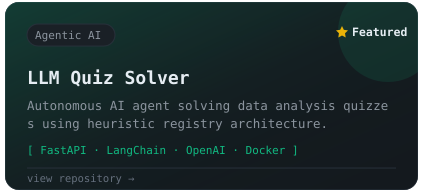
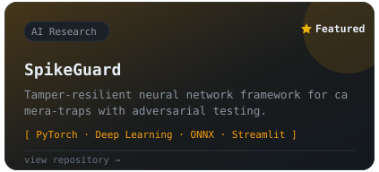
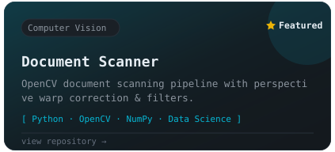
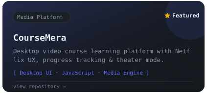

  

  <a href="https://linkedin.com/in/devansh-tripathi">LinkedIn</a> &nbsp;·&nbsp;
  <a href="mailto:gitternat2331@gmail.com">Email</a> &nbsp;·&nbsp;
  <a href="https://github.com/zetroretron">@zetroretron</a>

  

  

---

  B.Tech CSE (AI/ML) at VIT Bhopal &nbsp;·&nbsp; BS Data Science at IIT Madras &nbsp;·&nbsp; <i>"Building intelligent systems, one commit at a time."</i>

  

